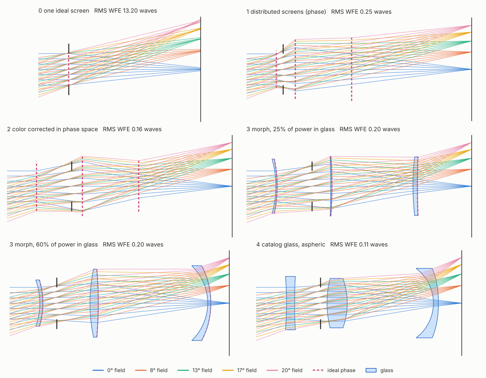
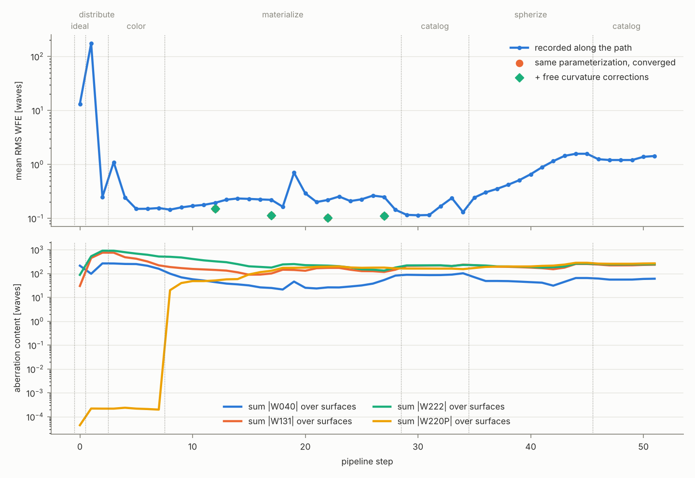

# NovaOptics

**Lens design that starts from ideal phase instead of from a lens.**

Conventional design starts from hardware: a list of surfaces with radii, thicknesses
and glasses, usually copied from a patent or a textbook form, then optimized
locally. NovaOptics flips the order. It first solves the optical *transformation*
with ideal, thin phase (OPD) screens, which are cheap to evaluate and have a smooth
merit landscape. It then **morphs** those screens continuously into real glass while
re-minimizing the merit function at every step.

Everything is a differentiable real-ray tracer in [JAX](https://github.com/jax-ml/jax), so every quantity,
including the continuation steps, has exact gradients.



## The idea in one interface law

Every interface uses one generalized law that covers refraction and an ideal phase
screen at the same time:

```
tangential(n' d') = tangential(n d) + grad_s W        and        OPL += W
```

With `W = 0` this is vector Snell's law. With flat surfaces it is a pure phase
screen. Each **element** is a slab of glass (two spherical, or optionally aspheric,
surfaces) that also carries a phase screen `W(r)`, so a single parameterization
spans the whole path from "ideal phase" to "real lens":

| | curvatures | thickness | phase `W` |
|---|---|---|---|
| ideal phase screen | 0 | 0 | everything |
| halfway through the morph | `s · phi` | ramps up | `(1 - s) · phi` + aspheric terms |
| real singlet | full | real | 0 |

## The pipeline

| stage | what happens | why it works |
|---|---|---|
| **0 IDEAL** | one achromatic phase screen at the stop | the best a single ideal thin element can do |
| **1 DISTRIBUTE** | split the power over N screens, optimize spacings and phase polynomials | phase screens are cheap and the landscape is smooth |
| **2 COLOR** | dispersion homotopy `beta: 0 → 1` in phase space; each screen disperses like a thin lens of its assigned glass `(n_d, V_d)`, which is free | color correction and glass choice happen while elements are still ideal |
| **3 MATERIALIZE** | homotopy `s: 0 → 1`: glass takes `s·phi_i` of each element's power, phase keeps `(1−s)·phi_i`; aspheric phase moves to aspheric sag as `b/(n−1)` | every step is a small, smooth deformation; at `s = 1` the phase is exactly zero |
| **4 CATALOG** | pull `(n_d, V_d)` toward real glasses, snap (trying the 2 nearest per element), re-optimize | discrete choice made last, from a good continuous solution |
| *(optional)* **SPHERIZE** | fade the aspheres out: `asph → (1−u)·asph` | for all-spherical designs |

**Architecture search happens in phase space.** Stages 1–2 run for several power
patterns (`+−+`, `−++`, `++−`, `+++`). That takes seconds, and only the best are
materialized.

### Two things the phase world has to be told

Pure phase screens are *too* ideal. Left alone, the phase world converges to
structures that glass cannot realize. Two first-order corrections, both physically
exact to thin-lens order, fix this:

1. **Virtual Petzval.** A phase screen has no Petzval curvature (it behaves like a
   lens with n → ∞). A screen of power `phi` that will become glass of index `n_d`
   will curve the image by `−phi/n_d`. So in the phase stages the image is
   evaluated on a surface pre-curved by `+Σ phi_i/n_d,i`. The correction fades out
   by itself as power moves into glass. Without it, three screens settle on a
   two-element `0, +, +` solution that cannot be achromatized or flattened. With it,
   negative elements appear on their own.
2. **Dispersive phase.** A screen disperses like a thin lens of its glass:
   `W(lambda) = W · (n(lambda) − 1)/(n_d − 1)`, switched on gradually by `beta`.

### Wavefront-carrying rays, for free

Generalized (Coddington) ray tracing, which propagates how a ray's neighbourhood
focuses, is just the Jacobian of the ray with respect to its pupil coordinates.
With forward-mode AD that is one `jax.jacfwd` call per field point.
`analysis.focus_shifts` uses it to get tangential and sagittal field curves from a
single chief ray per field.

## Results: f = 50 mm, F/4, ±20°, visible (F, d, C), 3 elements

Both workflows use the **same merit function** (polychromatic RMS wavefront error on
5 field points, EFL, distortion ≤ 2%, center/edge thicknesses, air gaps, track
≤ 80 mm), the **same damped-least-squares optimizer**, the **same glasses** (preferred
SCHOTT catalog, exact Sellmeier dispersion) and the **same glass selection**. They
differ only in where optimization starts:

* **phase-first**: no starting design at all.
* **conventional**: 12 randomly perturbed thin-lens Cooke triplets (`+−+`,
  SK16/F2/SK16 start, glasses then free), keeping the best.

Every result is judged on a **dense 21-point field grid** (and a denser pupil) that
no merit function sampled.

| design | glasses | mean RMS WFE [waves] | max RMS WFE [waves] | mean RMS spot [µm] | max distortion | wall time |
|---|---|---|---|---|---|---|
| phase-first, aspheric | N-SF66 / N-SK5 / SF6G05 | **0.122** | **0.182** | 3.5 | 0.83% | 449 s |
| conventional, aspheric | N-LASF44 / N-SF2 / N-LASF44 | 0.174 | 0.233 | 4.4 | 0.65% | 91 s |
| phase-first, spherical (asphere fade) | N-LASF41 / SF56A / N-LASF31A | **0.281** | **0.372** | 5.8 | 0.71% | 158 s* |
| conventional, spherical | N-LASF41 / N-SF6 / N-LASF31A | 0.311 | 0.431 | 5.9 | 0.80% | 60 s |

The aspheric phase-first design comes from the `−++` architecture, which became a
`−+−` form (a flint meniscus, a strong N-SK5 positive and a flint). The spherical
one comes from `+−+`, a Cooke-type triplet found without being given that form.

History of these numbers: the first version (thin-lens morph, two-term Cauchy glass)
reached 0.186 / 0.260 and 0.344 / 0.444 and lost to conventional on the mean. Free
curvature in the morph (see *Diagnostics*), real catalog glass with a
catalog-derived dispersion model, and gradual glass snapping (see *Real glasses*)
account for the difference.

\* on top of the aspheric run. Times are on 4 CPU cores and include JIT compilation.
Full prescriptions are in [`examples/output/results.md`](examples/output/results.md).


### What we learned (honest version)

* **Without a starting design, the pipeline now beats conventional multi-start from a
  known form**, on both mean and worst-field error, aspheric and spherical, with the
  same real glasses: 0.122 vs 0.174 (aspheric) and 0.281 vs 0.311 (spherical) mean. Conventional optimization from the *right* form (a
  Cooke triplet) is strong, but only 2 of 12 perturbed Cooke starts converged
  usefully, which shows how much that form knowledge and that luck matter.
* **The first version lost to conventional.** The improvement came from a
  diagnostic, not from tuning: the morph path gap showed its thin-lens curvature
  rule was the bottleneck.
* **It rediscovered the Cooke triplet** in the first version: a `+−+` triplet
  (N-LASF31A / N-SF11 / N-LASF31A) from a single ideal phase screen, with no lens
  form given. With free curvature the aspheric winner is a `−++`-derived design;
  the best spherical design is again `+−+`.
* **Phase-space ranking is a filter, not an oracle.** `−++` ranked first in phase
  space (0.13 waves) but materialized worse than `+−+`. Materializing the top two
  architectures was necessary, and spherizing each one picked `+−+` again (0.37
  vs 1.56 waves).
* **The phase world must be told about glass.** Without virtual Petzval, three
  ideal screens settle into a `0,+,+` solution that glass cannot realize.
* **Homotopies need bounded, meaningful variables.** An unbounded bending
  variable drifted to absurd values while glass carried little power and blew up
  later. A penalty-only morph made power jump all at once instead of migrating.
  Both are fixed in the reparameterization.
* **Merit sampling loopholes are real.** With 3 field points the optimizer
  overfit between fields. With 4 pupil rings and wavefront-only residuals,
  high-order aspheres hid steep wavefront walls between rings: 0.12 waves "RMS"
  but a 75 µm spot. The merit now uses 5 fields, 6 rings and transverse-ray
  residuals, and every number above is judged on a denser 21-field × 8×16-pupil
  grid.

## Diagnostics

`novaoptics.diagnostics` explains *why* a design performs as it does:

* **Seidel and primary-color contributions per surface** from a paraxial trace,
  including fourth-order aspheres and ideal phase screens through the Sweatt model.
  On a curved substrate the Sweatt lens needs a normal-path correction. These are
  validated against real-ray wavefront fits in `tests/test_diagnostics.py`.
* **Exact paraxial color** (all orders in Δn) next to the first-order C_I, C_II.
  In corrected designs the first-order values can be off by ~15%, because the
  total is a small difference of large terms.
* **Real-ray Hopkins fit** through fifth order, per wavelength.
* **Aberration content**: Σ|surface contribution| per term, i.e. how much
  aberration a design cancels rather than avoids.
* **Morph path gap**: re-optimizes recorded morph states to convergence, and with
  free curvature corrections.

`python examples/diagnose.py` writes [`examples/output/diagnostics/report.md`](examples/output/diagnostics/report.md).
What it showed, first on the **first version** of the pipeline (thin-lens morph,
Cauchy glass), which lost to conventional:

| spherical designs, first version | phase-first | conventional |
|---|---|---|
| Σ\|W040\| over surfaces | 140 waves | 42 |
| Σ\|W131\| over surfaces | 520 | 258 |
| real-ray W040 / W060 | +6.7 / −3.2 | +2.1 / −0.9 |
| exact axial color F−C | −151 µm | −44 µm |

* That phase-first spherical design **cancelled about 3× more spherical aberration
  and 2× more coma**, and balanced leftover high-order spherical aberration and
  axial color with defocus. That is why its field curves sat about 0.3 mm behind
  the image plane at every field. The conventional Cooke corrected coma element by
  element (< 15 waves each). The phase-first design cancelled −130 / +185 / −50 waves
  between elements, which predicts much tighter tolerances.
* **The cancellation was created in phase space.** Coma and astigmatism content was
  already 500–1000 waves at the distribute stage, because free aspheric phase lets
  each screen carry large compensating aberrations at no cost.
* **The morph was limited by its parameterization, not by convergence.** Running to
  convergence changed the path merit by < 1%. Adding free curvature corrections
  lowered it 3–7× (0.355 → 0.051 waves at s = 0.5, 0.663 → 0.168 at s = 1). That
  became the default.

On the **current** designs (real SCHOTT glass, free-curvature morph, gradual snap):

| current designs | Σ\|W040\| | Σ\|W131\| | Σ\|W222\| | real-ray W040 / W060 | exact axial color F−C |
|---|---|---|---|---|---|
| phase-first, aspheric | **102** | **235** | **230** | −0.49 / +0.23 | −62 µm |
| conventional, aspheric | 320 | 808 | 865 | +0.95 / +0.18 | −100 µm |
| phase-first, spherical | 63 | 337 | 566 | +3.50 / −1.63 | −124 µm |
| conventional, spherical | 52 | 296 | 542 | +2.76 / −1.23 | −90 µm |

* The **aspheric phase-first design cancels about 3× less aberration** than the
  conventional one, on top of the better image quality, so it should also be the
  more tolerant design.
* For spherical designs, the cancellation gap shrank from 2–3× to 10–20%.
* **Path gap now:** the morph carries free curvature, and the remaining gap is
  convergence. The recorded path sits about 2× above a converged re-optimization
  (0.220 → 0.113 at s = 0.5, 0.249 → 0.111 at s = 1). The polish and catalog stages
  recover most of it, but more iterations per morph step are an obvious next step.

| s | recorded | converged |
|---|---|---|
| 0.25 | 0.194 | 0.152 |
| 0.50 | 0.220 | 0.113 |
| 0.75 | 0.219 | 0.102 |
| 1.00 | 0.249 | 0.111 |

The morph figure below shows the chosen aspheric architecture (`−++`). Its spherized
tail is poor, which is why the example takes its spherical design from `+−+`.
The element plot compares the two current spherical designs.




## Real glasses

The designs use the **preferred SCHOTT catalog** (`schott2025.AGF`, 130 glasses after
removing optically identical transmission grades and AR waveguide wafers).
`novaoptics/catalog.py` reads Zemax AGF files: Sellmeier and Schott formulas,
status codes, validity ranges.

**PCA glass space.** Each glass is its index curve on a wavelength grid over the
design band, x = μ + B·a. Three coordinates (index level, dispersion, partial
dispersion) reproduce every glass to < 1·10⁻⁵ in index; two leave 1·10⁻⁴ (the
secondary-spectrum information). A snapped glass also keeps its small off-span
residual, so it is exact.

**Normal-glass model for continuous glasses.** While a glass is still continuous it
is an (n_d, V_d) point whose dispersion *shape* (n − n_d)/(n_F − n_C) is regressed
on (n_d, V_d) over the catalog. Its index-curve error against real glass is 7·10⁻⁶
rms, against 1.1·10⁻⁴ for a two-term Cauchy model, and n_d, V_d stay exact.
Continuous glasses are bounded by the catalog's convex hull in the glass map.

**Snapping.** Candidates are ranked by predicted merit |r + JΔ|², where J is the
Jacobian with respect to the glass coordinates, together with the glasses whose
index curves are nearest. The most promising combinations are snapped exactly
and re-optimized. Before snapping, a pull toward real glasses ramps up while
everything else re-optimizes. With `snap="gradual"` (the default in the example)
that pull already ramps up *during* the morph (ν ∝ s²).

What did not work, and why:

* **PCA coordinates as free continuous variables.** The color stage reached
  0.9–5 waves against 0.1–0.3 in (n_d, V_d). With a nearest-glass radius the
  feasible set is a scatter of small balls that traps the optimizer. With the 3-D
  convex hull it is still poorly conditioned.
* **A two-term Cauchy model.** All its glasses have the same dispersion shape, so
  continuous designs corrected color for glasses that do not exist. Snapping to
  real neighbours within 0.015 in n_d then cost 0.2 → 0.9 waves.
* **Snap timing** (aspheric, the two best architectures, before the final
  re-check):

| glasses snapped | mean / max RMS WFE [waves] |
|---|---|
| in phase space, fixed through the morph (`early`) | 0.177 / 0.292 |
| after the morph (`late`) | 0.187 / 0.265 |
| pull ramped during the morph (`gradual`) | **0.146 / 0.217** |

  (Measured before snap candidates switched to the pull's (n_d, V_d) metric, which
  later fixed a bad snap in the conventional baseline; the gradual result was
  reproduced afterwards in the full example, 0.122 / 0.182.)
  Snapping before the morph beats snapping after it on the mean. Committing glass
  gradually *while* the lens takes shape is better than either, and is the only
  mode where both architectures stay good.

* **The Cauchy model flattered earlier results** by 0.03–0.04 waves. Re-evaluated
  with exact Sellmeier dispersion and re-optimized at fixed glasses, the previous
  designs scored 0.123 / 0.171 (phase-first, aspheric) and 0.171 / 0.243
  (conventional, aspheric). All numbers in *Results* are with exact catalog glasses.

## Layout

```
novaoptics/
  glass.py         glass models: (n_d, V_d) Cauchy / normal-glass, PCA dispatch
  catalog.py       AGF reader, PCA glass space, normal-glass regression
  system.py        Layout / Spec / parameter pytree, prescription printout
  trace.py         differentiable ray tracer: sphere + asphere + phase interface
  analysis.py      wavefront error, spot, EFL, distortion, AD field curves
  diagnostics.py   Seidel/color contributions, real-ray fits, aberration content, path gap
  merit.py         residual vector with continuation knobs (beta, s, mu, nu, ...)
  optimize.py      Levenberg-Marquardt with exact JAX Jacobians
  continuation.py  the pipeline stages and architecture search
  baseline.py      conventional multi-start baseline
  plot.py          layouts, film strips, merit trajectory, performance plots
examples/design_triplet.py   runs everything, writes examples/output/
examples/diagnose.py         diagnostics report and figures
tests/                       physics and gradient checks
```

## Running

```bash
python -m venv .venv && . .venv/bin/activate
pip install -e ".[dev]"
pytest
python examples/design_triplet.py          # ~15-20 min on 4 CPU cores
python examples/design_triplet.py --quick  # smoke test
```

## Limitations and next steps

* **Model scope.** Rotationally symmetric systems, object at infinity, spherical
  surfaces with optional even aspheres on rear surfaces. There is no vignetting,
  ghost or tolerance analysis yet. Glass dispersion is a two-term Cauchy model from
  `(n_d, V_d)`, and the catalog is a small built-in list of nominal values.
* **Pupil.** Chief-ray aiming is exact, but the pupil grid is a circle on the
  incoming beam, so pupil aberrations are not modelled.
* **Phase-space ranking is blind to "sphere-friendliness".** The best aspheric
  architecture need not be the best all-spherical one. Ranking architectures by
  their materialized (not just phase-space) merit is the obvious fix.
* **Toward diffraction.** The rays already carry their local wavefront through AD.
  Gaussian-beamlet launching from those rays is the natural route to PSF/MTF near
  focus.
* **Toward freeform.** Nothing in the morph is tied to rotational symmetry. Phase
  screens and the phase-to-sag hand-off extend directly to XY polynomials.
