# NovaOptics

**Lens design that starts from ideal phase instead of from a lens.**

Conventional design starts from hardware: a list of surfaces with radii, thicknesses
and glasses, usually copied from a patent or a textbook form, then optimized
locally. NovaOptics flips the order. It first solves the optical *transformation*
with ideal, thin phase (OPD) screens, which are cheap to evaluate and have a smooth
merit landscape. It then **morphs** those screens continuously into real glass while
re-minimizing the merit function at every step.

Everything is a differentiable real-ray tracer in [JAX](https://github.com/jax-ml/jax), so every quantity,
including the continuation steps, has exact gradients.


## The idea in one interface law

Every interface uses one generalized law that covers refraction and an ideal phase
screen at the same time:

```
tangential(n' d') = tangential(n d) + grad_s W        and        OPL += W
```

With `W = 0` this is vector Snell's law. With flat surfaces it is a pure phase
screen. Each **element** is a slab of glass (two spherical, or optionally aspheric,
surfaces) that also carries a phase screen `W(r)`, so a single parameterization
spans the whole path from "ideal phase" to "real lens":

| | curvatures | thickness | phase `W` |
|---|---|---|---|
| ideal phase screen | 0 | 0 | everything |
| halfway through the morph | `s · phi` | ramps up | `(1 - s) · phi` + aspheric terms |
| real singlet | full | real | 0 |

## The pipeline

| stage | what happens | why it works |
|---|---|---|
| **0 IDEAL** | one achromatic phase screen at the stop | the best a single ideal thin element can do |
| **1 DISTRIBUTE** | split the power over N screens, optimize spacings and phase polynomials | phase screens are cheap and the landscape is smooth |
| **2 COLOR** | dispersion homotopy `beta: 0 → 1` in phase space; each screen disperses like a thin lens of its assigned glass `(n_d, V_d)`, which is free | color correction and glass choice happen while elements are still ideal |
| *(optional)* **GROW** | split the screen whose split helps most into two half-phase screens, until N elements | in phase space a split is first-order exact and nearly continuous; in glass it would be a jump |
| **3 MATERIALIZE** | homotopy `s: 0 → 1`: glass takes `s·phi_i` of each element's power, phase keeps `(1−s)·phi_i`; aspheric phase moves to aspheric sag as `b/(n−1)` | every step is a small, smooth deformation; at `s = 1` the phase is exactly zero |
| **4 CATALOG** | pull `(n_d, V_d)` toward real glasses, snap (candidates ranked by predicted merit), re-optimize | discrete choice made last, from a good continuous solution |
| *(optional)* **SPHERIZE** | fade the aspheres out: `asph → (1−u)·asph` | for all-spherical designs |

**Architecture search happens in phase space.** Stages 1–2 run for several power
patterns (`+−+`, `−++`, `++−`, `+++`). That takes seconds, and only the best are
materialized.

### Two things the phase world has to be told

Pure phase screens are *too* ideal. Left alone, the phase world converges to
structures that glass cannot realize. Two first-order corrections, both physically
exact to thin-lens order, fix this:

1. **Virtual Petzval.** A phase screen has no Petzval curvature (it behaves like a
   lens with n → ∞). A screen of power `phi` that will become glass of index `n_d`
   will curve the image by `−phi/n_d`. So in the phase stages the image is
   evaluated on a surface pre-curved by `+Σ phi_i/n_d,i`. The correction fades out
   by itself as power moves into glass. Without it, three screens settle on a
   two-element `0, +, +` solution that cannot be achromatized or flattened. With it,
   negative elements appear on their own.
2. **Dispersive phase.** A screen disperses like a thin lens of its glass:
   `W(lambda) = W · (n(lambda) − 1)/(n_d − 1)`, switched on gradually by `beta`.

### Wavefront-carrying rays, for free

Generalized (Coddington) ray tracing, which propagates how a ray's neighbourhood
focuses, is just the Jacobian of the ray with respect to its pupil coordinates.
With forward-mode AD that is one `jax.jacfwd` call per field point.
`analysis.focus_shifts` uses it to get tangential and sagittal field curves from a
single chief ray per field.

## Results: f = 50 mm, F/4, ±20°, visible (F, d, C), 3 elements

Both workflows use the **same merit function** (polychromatic RMS wavefront error on
5 field points, EFL, distortion ≤ 2%, center/edge thicknesses, air gaps, track
≤ 80 mm), the **same damped-least-squares optimizer**, the **same glasses** (preferred
SCHOTT catalog, exact Sellmeier dispersion), the **same glass selection** and the
**same stop shift**. They
differ only in where optimization starts:

* **phase-first**: no starting design at all.
* **conventional**: 12 randomly perturbed thin-lens Cooke triplets (`+−+`,
  SK16/F2/SK16 start, glasses then free), keeping the best.

Every result is judged on a **dense 21-point field grid** (and a denser pupil) that
no merit function sampled.

| design | glasses | mean RMS WFE [waves] | max RMS WFE [waves] | mean RMS spot [µm] | max distortion | wall time |
|---|---|---|---|---|---|---|
| phase-first, aspheric | N-SF66 / N-PK51 / SF56A | **0.102** | **0.157** | 2.9 | 0.51% | 103 s |
| conventional, aspheric | N-LASF41 / N-SF5 / N-LASF44 | 0.184 | 0.213 | 4.5 | 0.24% | 32 s |
| phase-first, spherical (asphere fade) | N-LASF41 / SF56A / N-LASF31A | **0.281** | **0.372** | 5.8 | 0.71% | 25 s* |
| conventional, spherical | N-LASF41 / N-SF6 / N-LASF31A | 0.311 | 0.431 | 5.9 | 0.80% | 10 s |

Both aspheric designs get a stop shift on the glass system (see *Stop shift*); neither
spherical design does. The aspheric phase-first design comes from the `−++`
architecture, which became a `−+−` form (a flint meniscus, a strong N-PK51 positive and
a flint). The spherical one comes from `+−+`, a Cooke-type triplet found without being
given that form. All four architectures are materialized: ranking by the aspheric
phase-space merit is the wrong filter for spherical designs.

History of these numbers: the first version (thin-lens morph, two-term Cauchy glass)
reached 0.186 / 0.260 and 0.344 / 0.444 and lost to conventional on the mean. Free
curvature in the morph (see *Diagnostics*), real catalog glass with a
catalog-derived dispersion model, gradual glass snapping (see *Real glasses*) and a
stop shift on the glass system account for the difference.

\* on top of the aspheric run. Times are on 4 CPU cores with a warm JAX compilation
cache (see *Performance*); the whole example takes about 3 min (280 s from a cold
cache).
Full prescriptions are in [`examples/output/results.md`](examples/output/results.md).

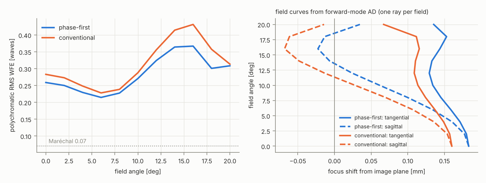

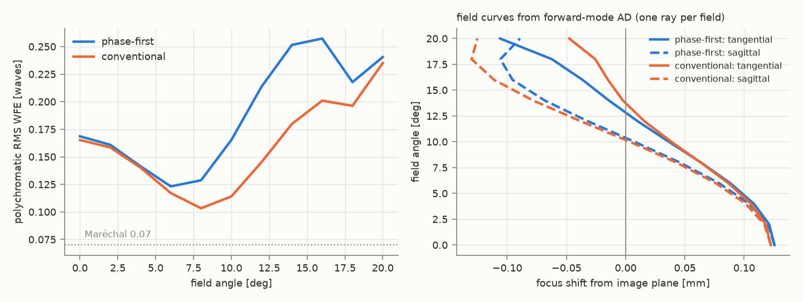

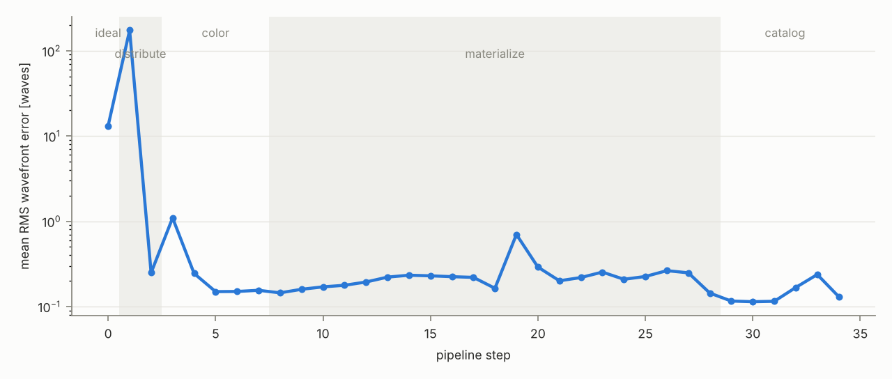

### What we learned (honest version)

* **Without a starting design, the pipeline now beats conventional multi-start from a
  known form**, on both mean and worst-field error, aspheric and spherical, with the
  same real glasses and the same stop shift: 0.102 vs 0.184 (aspheric) and 0.281 vs
  0.311 (spherical) mean. Conventional optimization from the *right* form (a
  Cooke triplet) is strong, but only 2 of 12 perturbed Cooke starts converged
  usefully, which shows how much that form knowledge and that luck matter.
* **The first version lost to conventional.** The improvement came from a
  diagnostic, not from tuning: the morph path gap showed its thin-lens curvature
  rule was the bottleneck.
* **It rediscovered the Cooke triplet** in the first version: a `+−+` triplet
  (N-LASF31A / N-SF11 / N-LASF31A) from a single ideal phase screen, with no lens
  form given. With free curvature the aspheric winner is a `−++`-derived design;
  the best spherical design is again `+−+`.
* **Phase-space ranking is a filter, not an oracle.** `−++` ranked first in phase
  space (0.13 waves) but materialized worse than `+−+`. Materializing the top two
  architectures was necessary, and spherizing each one picked `+−+` again (0.37
  vs 1.56 waves).
* **The phase world must be told about glass.** Without virtual Petzval, three
  ideal screens settle into a `0,+,+` solution that glass cannot realize.
* **Homotopies need bounded, meaningful variables.** An unbounded bending
  variable drifted to absurd values while glass carried little power and blew up
  later. A penalty-only morph made power jump all at once instead of migrating.
  Both are fixed in the reparameterization.
* **Merit sampling loopholes are real.** With 3 field points the optimizer
  overfit between fields. With 4 pupil rings and wavefront-only residuals,
  high-order aspheres hid steep wavefront walls between rings: 0.12 waves "RMS"
  but a 75 µm spot. The merit now uses 5 fields, 6 rings and transverse-ray
  residuals, and every number above is judged on a denser 21-field × 8×16-pupil
  grid.

## Diagnostics

`novaoptics.diagnostics` explains *why* a design performs as it does:

* **Seidel and primary-color contributions per surface** from a paraxial trace,
  including fourth-order aspheres and ideal phase screens through the Sweatt model.
  On a curved substrate the Sweatt lens needs a normal-path correction. These are
  validated against real-ray wavefront fits in `tests/test_diagnostics.py`.
* **Exact paraxial color** (all orders in Δn) next to the first-order C_I, C_II.
  In corrected designs the first-order values can be off by ~15%, because the
  total is a small difference of large terms.
* **Real-ray Hopkins fit** through fifth order, per wavelength.
* **Aberration content**: Σ|surface contribution| per term, i.e. how much
  aberration a design cancels rather than avoids.
* **Morph path gap**: re-optimizes recorded morph states to convergence, and with
  free curvature corrections.

`python examples/diagnose.py` writes [`examples/output/diagnostics/report.md`](examples/output/diagnostics/report.md).
What it showed, first on the **first version** of the pipeline (thin-lens morph,
Cauchy glass), which lost to conventional:

| spherical designs, first version | phase-first | conventional |
|---|---|---|
| Σ\|W040\| over surfaces | 140 waves | 42 |
| Σ\|W131\| over surfaces | 520 | 258 |
| real-ray W040 / W060 | +6.7 / −3.2 | +2.1 / −0.9 |
| exact axial color F−C | −151 µm | −44 µm |

* That phase-first spherical design **cancelled about 3× more spherical aberration
  and 2× more coma**, and balanced leftover high-order spherical aberration and
  axial color with defocus. That is why its field curves sat about 0.3 mm behind
  the image plane at every field. The conventional Cooke corrected coma element by
  element (< 15 waves each). The phase-first design cancelled −130 / +185 / −50 waves
  between elements, which predicts much tighter tolerances.
* **The cancellation was created in phase space.** Coma and astigmatism content was
  already 500–1000 waves at the distribute stage, because free aspheric phase lets
  each screen carry large compensating aberrations at no cost.
* **The morph was limited by its parameterization, not by convergence.** Running to
  convergence changed the path merit by < 1%. Adding free curvature corrections
  lowered it 3–7× (0.355 → 0.051 waves at s = 0.5, 0.663 → 0.168 at s = 1). That
  became the default.

On the **current** designs (real SCHOTT glass, free-curvature morph, gradual snap,
stop shift on the glass system for both aspheric designs):

| current designs | Σ\|W040\| | Σ\|W131\| | Σ\|W222\| | real-ray W040 / W060 | exact axial color F−C |
|---|---|---|---|---|---|
| phase-first, aspheric | **65** | **187** | **183** | +0.59 / −0.35 | −58 µm |
| conventional, aspheric | 272 | 694 | 743 | +2.00 / −0.50 | −137 µm |
| phase-first, spherical | 63 | 337 | 566 | +3.50 / −1.63 | −124 µm |
| conventional, spherical | 52 | 296 | 542 | +2.76 / −1.23 | −90 µm |

* The **aspheric phase-first design cancels 3.7–4.2× less aberration** than the
  conventional one. It balances less high-order spherical aberration and has less
  than half the axial color, on top of the better image quality, so it should also
  be the more tolerant design. (An earlier version of this table evaluated the
  conventional aspheric design with the stop in the wrong place; results.json now
  stores each design's layout.)
* For spherical designs, the cancellation gap shrank from 2–3× to 10–20%.
* **Path gap now:** the morph carries free curvature, and the remaining gap is
  convergence. Mid-morph the recorded path sits up to 2.4× above a converged
  re-optimization; by the end of the morph the gap has nearly closed (0.192 vs
  0.170 at s = 1). More iterations per morph step remain an easy next step.

| s | recorded | converged |
|---|---|---|
| 0.25 | 0.200 | 0.145 |
| 0.50 | 0.275 | 0.115 |
| 0.75 | 0.192 | 0.113 |
| 1.00 | 0.192 | 0.170 |

The morph figure below shows the chosen aspheric architecture (`−++`). Its spherized
tail is poor, which is why the example takes its spherical design from `+−+`.
The element plot compares the two current spherical designs.

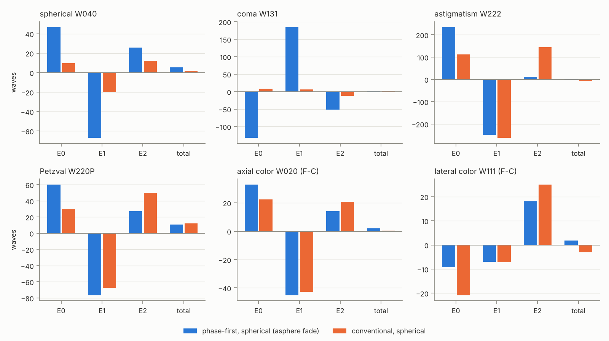


## Real glasses

The designs use the **preferred SCHOTT catalog** (`schott2025.AGF`: 130 preferred
glasses, 114 after removing optically identical transmission grades and AR
waveguide wafers; obsolete/inquiry glasses are not used).
`novaoptics/catalog.py` reads Zemax AGF files: Sellmeier and Schott formulas,
status codes, validity ranges.

**PCA glass space.** Each glass is its index curve on a wavelength grid over the
design band, x = μ + B·a. Three coordinates (index level, dispersion, partial
dispersion) reproduce every glass to < 1·10⁻⁵ in index; two leave 1·10⁻⁴ (the
secondary-spectrum information). A snapped glass also keeps its small off-span
residual, so it is exact.

**Normal-glass model for continuous glasses.** While a glass is still continuous it
is an (n_d, V_d) point whose dispersion *shape* (n − n_d)/(n_F − n_C) is regressed
on (n_d, V_d) over the catalog. Its index-curve error against real glass is 7·10⁻⁶
rms, against 1.1·10⁻⁴ for a two-term Cauchy model, and n_d, V_d stay exact.
Continuous glasses are bounded by the catalog's convex hull in the glass map.

**Snapping.** Candidates are ranked by predicted merit |r + JΔ|², where J is the
Jacobian with respect to the glass coordinates, together with the glasses whose
index curves are nearest. The most promising combinations are snapped exactly
and re-optimized. Before snapping, a pull toward real glasses ramps up while
everything else re-optimizes. With a catalog, that pull already ramps up *during*
the morph (ν ∝ s², `glass_pull`).

What did not work, and why:

* **PCA coordinates as free continuous variables.** The color stage reached
  0.9–5 waves against 0.1–0.3 in (n_d, V_d). With a nearest-glass radius the
  feasible set is a scatter of small balls that traps the optimizer. With the 3-D
  convex hull it is still poorly conditioned.
* **A two-term Cauchy model.** All its glasses have the same dispersion shape, so
  continuous designs corrected color for glasses that do not exist. Snapping to
  real neighbours within 0.015 in n_d then cost 0.2 → 0.9 waves.
* **Snap timing** (aspheric, the two best architectures, before the final
  re-check):

| glasses snapped | mean / max RMS WFE [waves] |
|---|---|
| in phase space, fixed through the morph (`early`) | 0.177 / 0.292 |
| after the morph (`late`) | 0.187 / 0.265 |
| pull ramped during the morph (`gradual`) | **0.146 / 0.217** |

  (Measured before snap candidates switched to the pull's (n_d, V_d) metric, which
  later fixed a bad snap in the conventional baseline; the gradual result was
  reproduced afterwards in the full example, 0.122 / 0.182.)
  Snapping before the morph beats snapping after it on the mean. Committing glass
  gradually *while* the lens takes shape is better than either, and is the only
  mode where both architectures stay good.

* **The Cauchy model flattered earlier results** by 0.03–0.04 waves. Re-evaluated
  with exact Sellmeier dispersion and re-optimized at fixed glasses, the previous
  designs scored 0.123 / 0.171 (phase-first, aspheric) and 0.171 / 0.243
  (conventional, aspheric). All numbers in *Results* are with exact catalog glasses.

## Stop shift

`novaoptics/stopshift.py` applies stop-shift theory. Moving the stop to z_s adds
E = −ȳ(z_s)/y(z_s) times the marginal ray to the chief ray, and the third-order sums
change in closed form:

S_II* = S_II + E·S_I, S_III* = S_III + 2E·S_II + E²·S_I,
S_V* = S_V + E(3S_III + S_IV) + 3E²S_II + E³S_I, C_II* = C_II + E·C_I,
while S_I, S_IV and C_I do not change.

The color rules follow from the last line. With axial color present, lateral color
is linear in stop position and vanishes at one position. With axial color
corrected, lateral color does not depend on the stop, and the stop is free for coma,
astigmatism and field curvature. The closed-form sums agree with a full Seidel
retrace at the moved stop to 10⁻⁶ (`tests/test_stopshift.py`).

**STOP-SHIFT stage** (on the materialized glass system, before CATALOG;
`design_from_phase(stop_shift=True)`):

1. Scan every stop position in air.
2. Score each on third-order coma, astigmatism and sagittal field curvature.
3. Move the stop to the best few positions and re-optimize each with the real-ray
   merit. The current position is always a candidate, so the stage cannot make
   things worse.

The experiments below also ran the stage in phase space (after COLOR, where the stop
can move across the thin screens) and an "axial color first" ordering. Both were
removed from the code after these results.

**Finding: the merit does not correct axial color first.** After the original COLOR
stage, primary axial color was still about 1.7 waves F−C. Seidel, exact paraxial and
real-ray fits agree, so this is not a modelling error. The polychromatic merit
*balances* axial color against spherochromatism instead of zeroing it, which
violates the precondition of the stop-shift ordering. With a total-axial-color term
in the merit, COLOR can correct it explicitly. In phase space (mean RMS WFE on the
design surface):

| architecture | color by merit → stop shift | axial color first → stop shift |
|---|---|---|
| `+−+` | 0.358 → 0.358 | 0.461 → 0.434 |
| `−++` | 0.155 → **0.132** | 3.89 → 0.248 |
| `++−` | 0.656 → 0.655 | 0.155 → **0.118** |
| `+++` | 0.370 → **0.144** | 2.49 → 2.00 |

The stop shift helps whenever the stop has somewhere better to go. The stop-shift
ordering wins outright for `++−`, which had always ranked last and becomes the best
architecture. It hurts where the best design balances axial color against
spherochromatism.

**Where to apply it.** Phase space vs. the materialized glass system (stop in air
gaps, real thicknesses, glass-system variables). Full pipeline, aspheric and spherized
designs, mean / max RMS WFE on the dense grid:

| stop shift in phase space | stop shift on the glass system | aspheric | spherical |
|---|---|---|---|
| — | — | 0.122 / 0.182 | **0.281 / 0.372** |
| ✓ | — | 0.119 / 0.172 | 0.489 / 0.581 |
| — | ✓ | **0.102 / 0.157** | 0.286 / 0.405 |
| ✓ | ✓ | 0.108 / 0.158 | 0.307 / 0.394 |

* **Stop-shift theory pays off where traditional design applies it: on the real glass
  system.** It gives the best aspheric design, 17% better.
* **In phase space it misleads.** Elements there are thin and freely aspheric, so the
  best stop for them is not the best stop for thick glass. For `+−+` it moved the stop
  in front of the first element. The spherized Cooke-type design then got worse
  (0.28 → 0.49), and a later glass-stage shift recovered most of it (0.31).
* For spherical designs the glass-stage shift does not help either (0.286 vs 0.281,
  within run-to-run variation).
* The pipeline therefore applies the stop shift on the glass system only
  (`stop_shift=True`). The phase-space stage and the axial-color-first ordering were
  removed. They made `++−` competitive in phase space, but did not produce better
  final lenses.

## Element bending

A phase screen carries only an element's net optical path. How the glass element is
bent (biconvex, meniscus, ...) has to be found during the morph.

**Lock-in is real.** One phase design, morphed from eight starting bendings (shape
factors X): five ended at 0.101–0.114 waves, three at 0.224–0.306. Elements 2 and 3
always converge to the same shape. Element 1 lands in one of two basins (X ≈ +1.7 or
X ≈ +5…+7), and which one depends on the starting combination in a way that is hard to
predict.

**What did not work, and why:**

* **Two separated phase screens per element** (front and back face; implemented and
  validated in the tracer and Seidel trace, then removed). Splitting the power between them changes coma
  by only 6–20%, where bending a glass lens of the same power changes it ~10× and flips
  its sign. Ideal screens act like lenses of infinite index, and thin-lens shape
  dependence vanishes as n → ∞. The split carries almost no bending information.
* **A third-order bending scan before the morph** (3,375 combinations in 1 s; removed). Its predictions do not correlate with the outcome: the morph moves the bending a
  long way. Seeding the morph with the scan's top picks gave 0.139 / 0.114 / 0.247, no
  better than blind starts.
* **Third-order theory after the morph** cannot choose either. A design in the bad
  basin is fully corrected in third order (each element's scan has a single minimum at
  its current bending). The basins differ in **fifth-order** residuals.

**What works: bending hops** (`stage_bending_hops`). Re-bend each element to a few
alternative shapes, re-polish with the real-ray merit, keep improvements. A short
polish from a forced bending reaches the good basin: the 0.306 design goes to 0.100
when element 1 is forced to X = 1.7, 3.0 or 4.5, and to 0.112 with the greedy hops.
In the full pipeline, though, the default morph already lands well, and hops did not
improve the final designs (0.106 / 0.161 aspheric and 0.307 / 0.394 spherical, vs.
0.102 / 0.157 and 0.281 / 0.372 without them, at +17% run time). They are therefore an
off-by-default option (`bending_hops=True`): insurance against a bad basin, not a gain
when the morph already did well.

## Multi-element designs: growing lenses from phase

`design_from_phase(..., n_elem=N)` grows the 3-screen architectures to N elements in
phase space before the morph (stage GROW, `grow.py`):

* **Split.** A screen becomes two screens, each with half the aspheric phase, placed
  symmetrically about the original position, a distance d apart. Each half gets the
  power φ′ that solves 2φ′ − dφ′² = φ, so the pair has the original power and its
  principal planes stay within O(d²φ) of the original screen: EFL and image position
  are preserved, and a screen in the stop plane ends up straddling the stop. A glass
  element cannot be split this way, because two thick lenses are not one lens.
* **Which screen.** Every candidate split is re-optimized in phase space concurrently
  and the best is kept, greedily, until N elements. For the first split this ranking
  predicts the glass result: materializing all three 3→4 candidates gave the same
  order at F/4 and at F/2.8. By 5 screens the phase merit is nearly perfect and stops
  ranking realizability. At 5→6 the best final design came from the split with the
  worst phase cost, and no phase-space proxy tested (aspheric phase content,
  thin-lens φ³h⁴ spherical, an asphericity penalty) predicted it.
* **Room for glass.** Splits pack screens 2 mm apart, which suits some designs and
  leaves no room for real lenses in others. Each architecture is therefore grown at
  two spacings, 2 mm and 4 mm (thickness + clearance), and all variants are materialized
  and judged by the real merit, like the architectures.

Growing more elements also needed two engineering fixes. The morph now uses
**adaptive homotopy steps**: a step whose image quality jumps is halved. A
6-element morph with fixed steps ended at 2.1 waves, and at 0.43 adaptively; the
3-element example designs are unchanged. **Compiled programs are bounded by memory
mappings and RSS.** Each XLA program holds thousands of mappings, and Linux caps them
per process; a 6-element study had aborted inside LLVM, and later reached 14 GB.

Results (`examples/design_multilens.py`, f = 50 mm, ±20°, F/d/C, all-spherical,
preferred SCHOTT glasses, dense 21-field grid, all four architectures):

| design | from | mean RMS WFE [waves] | max RMS WFE [waves] | mean RMS spot [µm] | time |
|---|---|---|---|---|---|
| F/4, 3 elements | `+−+` | 0.286 | 0.405 | 6.0 | 60 s |
| F/4, 4 elements | `+−+` @2 mm | 0.183 | 0.233 | 4.3 | 154 s |
| F/4, 5 elements | `+−+` @2 mm | **0.137** | 0.230 | 3.6 | 309 s |
| F/4, 6 elements | `+−+` @4 mm | 0.192 | 0.249 | 4.0 | 618 s |
| F/2.8, 3 elements | `+++` | 0.781 | 1.028 | 11.0 | 47 s |
| F/2.8, 4 elements | `++−` @4 mm | 0.497 | 0.651 | 8.5 | 157 s |
| F/2.8, 5 elements | `+−+` @4 mm | 0.432 | 0.540 | 7.4 | 314 s |
| F/2.8, 6 elements | `++−` @4 mm | **0.407** | 0.545 | 7.5 | 649 s |

Growing roughly halves the error from 3 to 5 elements at both apertures. The curve is
not yet monotone: the 6-element F/4 design is worse than the 5-element one, although
the 6-element space contains something close to it. Greedy growth commits to one
split per step, and beyond the first split phase space cannot say which one glass
will like. Next steps: materialize several split candidates at the last step (costly),
or start from 4- and 5-screen power patterns.

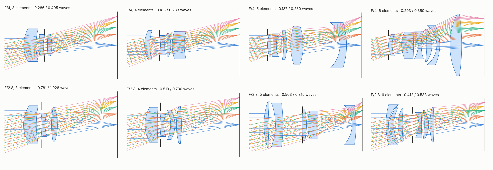

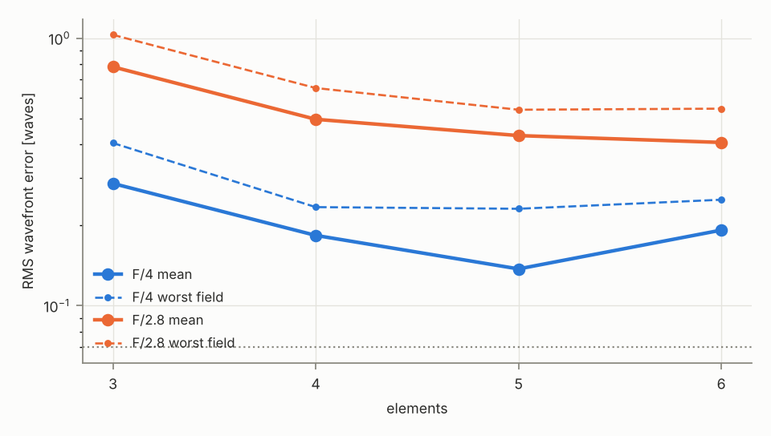

## Native components: continuing, cementing, importing

Every design is a sequence of **components**: lens (singlet or cemented group), phase
screen, mirror, stop, coordinate break, dummy, image. Phase screens are *ideal*
(achromatic), *glass* (disperses like the glass it sits on, as in the
phase-to-glass morph), *diffractive* (OPD proportional to the wavelength) or a linear
*grating* (lines/mm, order; wavelength dependent). Surface-by-surface data (the lens
data editor, a Zemax file) is grouped into components automatically
(`engine/components.py`); the surface engine underneath only traces them. Pipeline
designs convert exactly, including residual phase.

The design model on top (`engine/merit.py`, `engine/design.py`) has its own merit
(the element model's, plus air spaces around a stop, edge thickness of cemented
groups, virtual Petzval for phase screens) and **multi-configuration**: a
configuration overrides any surface parameters with its own variables and may have
its own wavelengths, fields and focal-length target. The phase-first operations
work on components, and every structural change starts exactly continuous:

* **add an element** (`add_element`): a zero-power phase screen on a zero-thickness
  slab of model glass is inserted into every air space (and in front). The screen
  disperses like its slab, whose glass is free, so color is corrected in phase space
  as in the pipeline's COLOR stage. Each candidate is optimized, morphed into glass
  (adaptive steps), polished and snapped to the catalog; the best real merit wins.
  The phase-space merit did not predict the best position here either.
* **cement** (`cement`): a zero-thickness layer of a new glass, conformal with the
  element's rear surface, is inserted and grown (its minimum thickness ramped in).
  The glass is chosen discretely from eight preferred glasses spread over the glass
  map (k-means). A continuous model glass ran to unphysical (n_d, V_d), or stalled at
  the edge of the glass map.
* **materialize** a phase screen into a lens (also a bare imported screen, e.g. a
  Zemax paraxial surface), and **dematerialize** a singlet into a screen. The screen
  keeps the lens' paraxial matrix exactly (power and principal planes: a thin screen
  with spaces a = (1 − D)/φ and b = (1 − A)/φ has the lens' [[A, B], [C, D]]), and it
  disperses like the lens' glass. Its aspheric phase is fitted to the lens' ray
  deviations. Beyond first order a thin screen cannot stand in for a thick lens in a
  tightly balanced design (the triplet's rear element: 0.30 → 4.3 waves as a
  screen), but materializing it again returns 0.295: it is a phase-space starting
  point for re-shaping one element, not a lossless swap.

`examples/continue_design.py` continues the 3-element all-spherical phase-first
design (dense 21-field grid, preferred SCHOTT glasses):

| design | mean RMS WFE [waves] | max RMS WFE [waves] |
|---|---|---|
| 3 elements (start) | 0.281 | 0.372 |
| + 1 air-spaced element (best: in the back focal space) | **0.178** | **0.235** |
| cemented (flint F2G12 behind the first element) | 0.227 | 0.280 |

Cementing the thin middle negative only made it worse (≥ 0.42): it can only get
thicker.

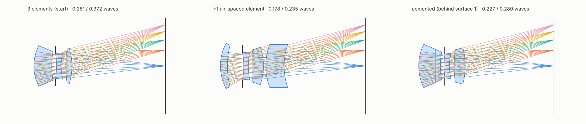

**Multi-configuration** (`examples/multiconfig.py`, about 4 min). Each configuration is
a set of surface-parameter overrides (its own variables, or fixed values), plus
optional own wavelengths, fields and focal-length target. Configurations of the same
structure are evaluated as one batch, so the compiled program does not grow with their
number (Jacobian compile 26 / 33 / 38 s for 1 / 3 / 5 configurations, instead of about
+29 s each). Catalog glasses are data, so every glass combination a snap tries shares
one program.

* *Zoom*, three model-glass singlets (+ − +), with both spacings per configuration
  and a shared back focus: all focal lengths are met (35.00 / 50.00 / 69.99 mm), but
  three singlets correct a 2× zoom poorly (0.4–1.6 waves). This demonstrates the
  mechanics, not a zoom design.
* *Spectrum from defocus*: a cemented doublet with intentional axial color. Each
  wavelength from 450 to 850 nm is its own configuration, evaluated alone in its own
  image plane. The planes are prescribed, 0.4 mm per 100 nm, and the lens is
  optimized to put every wavelength on its plane:

| wavelength | 450 nm | 550 nm | 650 nm | 750 nm | 850 nm |
|---|---|---|---|---|---|
| image plane [mm] | 47.2 | 47.6 | 48.0 | 48.4 | 48.8 |
| RMS WFE on axis / 2° [waves] | 0.06 / 0.12 | 0.17 / 0.14 | 0.13 / 0.10 | 0.01 / 0.04 | 0.12 / 0.15 |

  `per_wavelength_focus` sets this up from any design (*Design → Per-wavelength
  focus*), with the planes free. Fixing them, or constraining their spacing, makes
  axial color a design target.

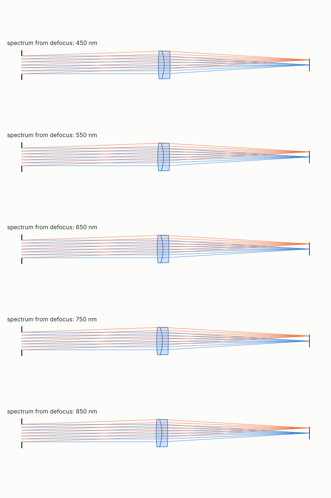

**Zemax files** (`engine/zmx.py`, *File → Import / Export .zmx*): UTF-16 or UTF-8,
lens units, ENPD or FNUM, wavelengths, angle fields; STANDARD, EVENASPH, COORDBRK,
DGRATING (as a grating screen), PARAXIAL (as an ideal screen); catalog, model and
MIRROR glasses. Unsupported content (other surface types, a finite object distance,
other field types, multi-configuration data) is refused with a message naming it.
The multi-configuration (MCE) records are not read yet. Tilt signs follow the engine's
right-handed convention; check fold mirrors of imported files.

## Performance

Profiling one architecture path of the aspheric pipeline (236 s originally) showed
that the optimizer's numerics were only about 19% of the time: 42% was XLA
compilation and 39% was Python-side overhead (unjitted summaries, re-tracing). The
algorithm was not the bottleneck, so the gains come from the implementation:

| change | effect |
|---|---|
| implicit differentiation of chief-ray aiming (`custom_jvp`) instead of differentiating through Newton | Jacobian program several times smaller, compiles faster |
| Newton loops (aiming, asphere intercepts) as `lax.fori_loop`, not unrolled | smaller programs, faster compiles |
| jit-compiled summaries; compiled residual / Jacobian reused per layout (LRU, per-entry lock) | no re-tracing; bounded memory |
| persistent JAX compilation cache (`~/.cache/novaoptics/jax`, `NOVAOPTICS_JAX_CACHE`) | second and later runs skip most compiles |
| independent optimizations run in threads (`parallel.pmap`): architectures, snap candidates, stop positions, bending-hop alternatives, multi-starts | 1.7× with 2 threads, 2.1× with 4 (XLA releases the GIL) |

One path: 236 s → 61.5 s; the full example: ~1700 s → 280 s cold, 179 s warm, with
identical results. A Jacobian is now about 25 ms (34 parameters, ~3400 residuals) and
Jacobians are about 60% of the remaining optimizer time.

**Is Levenberg–Marquardt the right algorithm?** Yes for this problem: a few dozen
parameters, thousands of residuals, an exact Jacobian from forward-mode AD, and a
continuation that keeps every solve close to a minimum. LM with Marquardt damping
converges in a handful of iterations per continuation step. Tried and reverted:
Nielsen damping updates (final 0.112 vs 0.102 waves) and a looser stopping tolerance
(1e-7: 0.108); both stop earlier along the morph and lose quality downstream.
`vmap`-batching independent optimizations gave no speedup on the CPU (it may on a GPU);
threads did.

**C++ / AVX-512.** With compile time and overhead gone, a hand-written tracer with
forward-mode dual numbers vectorized over rays could plausibly give another 2–3× on
the Jacobians, at the cost of re-implementing the tracer, the asphere and aiming
derivatives and the merit. That is deferred until the method has settled.

## Surface engine (general systems)

`novaoptics.engine` is a general sequential ray tracer, the base for multi-element,
reflective and off-axis systems. The phase-first pipeline above still uses the element
model, and `engine.convert.from_layout` turns its designs into engine systems; the two
tracers agree to 1e-14 mm on all four example designs.

* **Surfaces:** conic; even asphere; Forbes Q-type, type 0 = Qbfs (best-fit sphere,
  slope-orthogonal) and type 1 = Qcon (conic plus sag-orthogonal); the polynomials
  match Forbes' published Q0–Q4 to 1e-13. Phase: ideal (achromatic OPD), diffractive
  (OPD ∝ order·λ), and linear gratings (lines/mm, any order).
* **Interactions:** one law for refraction, reflection and phase,
  `tangential(n'd') = tangential(n d) + ∇W`. Misses, total internal reflection and
  evanescent orders are flagged, never NaN.
* **Geometry:** coordinate breaks (decenter/tilt, either order) and signed thicknesses
  after mirrors, as in common lens design programs; 2-D fields; chief-ray aiming to an
  aiming point on the stop, so off-axis apertures of coaxial parents work. The aiming
  is differentiated implicitly.
* **Analysis** (`engine.analysis`): OPD maps; spot diagrams with RMS, GEO and Airy
  radius; FFT PSF (polychromatic, with Strehl ratio), sampled from the real image-space
  direction cosines; and sagittal/tangential MTF against the diffraction limit. These
  are checked against the Airy first zero, the closed-form diffraction-limited MTF
  (within 0.02), the exact Strehl ratio of quarter-wave defocus (0.81), and the ray
  centroid. In the GUI they appear in the **Image analysis** tab.

```python
from novaoptics.engine import Builder, Spec, analysis
b = Builder()
b.mirror(c=-1/200, k=-1, stop=True, t=-100, sy=30)   # off-axis section of an f/5 parabola
b.image()
system, params = b.build()
spec = Spec(epd=20, fields=((0, 0), (0, 0.5)), wavelengths=(0.5876,))
res = analysis.analyze(params, system, spec, (0, 0.5))   # spot, OPD, PSF, MTF
```

## GUI

```bash
pip install -e ".[gui]"
novaoptics-gui                                   # or: python -m novaoptics.gui
novaoptics-gui examples/output/results.json      # open saved designs
```

A PySide6 front end for the pipeline. Set the specification, the workflow
(phase-first or conventional multi-start), architectures, catalog, manufacturing
limits and threads, then **Run**. The run happens in a background thread, and every
recorded pipeline step streams into the **Layout** tab while it runs: the phase
screens turn into glass live (dashed magenta = ideal phase that remains). After the
run, the slider scrubs through every step of a design's path. **Merit** shows the
trajectory (one line per architecture while running), **Performance** compares the
selected designs on a dense field grid (RMS wavefront error, spot, AD field curves,
distortion), **Image analysis** shows the spot diagram, OPD map, PSF and MTF of the
selected design at a chosen field, and **Prescription** and **Log** show the details. **Stop** takes
effect within one optimizer step. Designs can be saved and reopened as JSON, including
their layout and catalog, and figures can be exported.

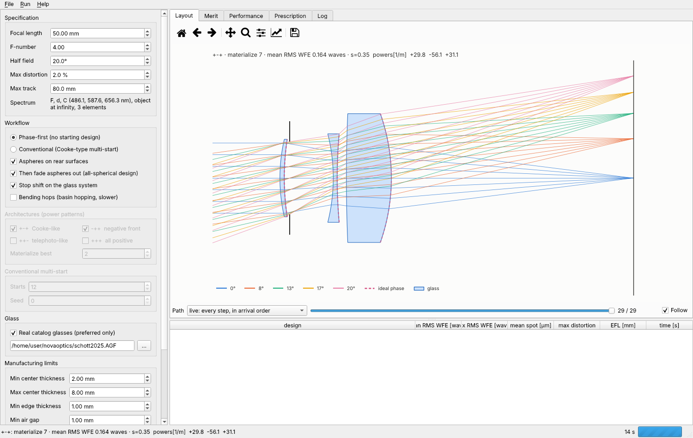

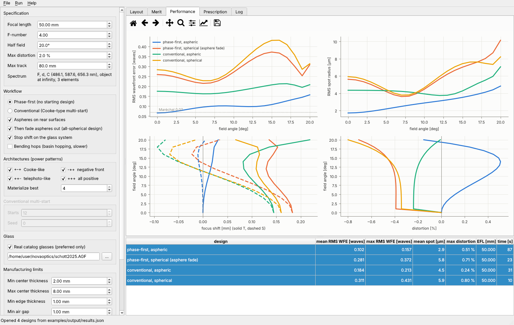

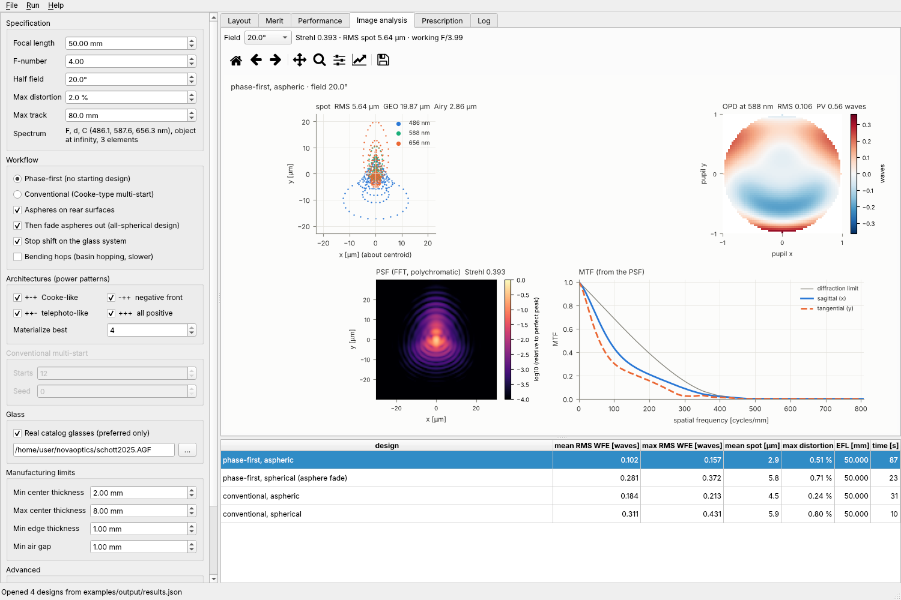

## Layout

```
novaoptics/
  glass.py         glass models: (n_d, V_d) Cauchy / normal-glass, PCA dispatch
  catalog.py       AGF reader, PCA glass space, normal-glass regression
  stopshift.py     stop-shift relations, stop-position scan, relayout
  bending.py       element re-bending (for bending hops)
  grow.py          first-order-preserving screen splits, GROW stage
  system.py        Layout / Spec / parameter pytree, prescription printout
  trace.py         differentiable ray tracer: sphere + asphere + phase interface
  analysis.py      wavefront error, spot, EFL, distortion, AD field curves
  diagnostics.py   Seidel/color contributions, real-ray fits, aberration content, path gap
  merit.py         residual vector with continuation knobs (beta, s, mu, nu, ...)
  optimize.py      Levenberg-Marquardt with exact JAX Jacobians
  continuation.py  the pipeline stages and architecture search
  baseline.py      conventional multi-start baseline
  plot.py          layouts, film strips, merit trajectory, performance plots
  progress.py      snapshot listeners and cooperative cancel (for front ends)
  gui/runner.py    Qt-free run options, jobs, evaluation, JSON save/load
  gui/app.py       PySide6 main window; gui/lensdata.py lens data / configuration editor
  engine/          general sequential surface engine: system.py (surfaces, frames),
                   trace.py, qpoly.py (Forbes Q), materials.py, analysis.py (spot,
                   OPD, PSF, MTF, field curves), plots.py, convert.py,
                   components.py (native components), merit.py (merit, multi-
                   configuration), design.py (add element, cement, materialize,
                   dematerialize, glass snap, per-wavelength focus), zmx.py
examples/design_triplet.py   runs everything, writes examples/output/
examples/diagnose.py         diagnostics report and figures
tests/                       physics and gradient checks
```

## Running

JAX runs on the CPU by default (set in `novaoptics/__init__.py`; set `JAX_PLATFORMS`
to override). The optimization is many small, sequential, latency-bound steps, and on
a GPU the example ran about 1.5× slower than on the CPU. `NOVAOPTICS_THREADS` sets the
number of worker threads (default: CPU count).

```bash
python -m venv .venv && . .venv/bin/activate
pip install -e ".[dev]"
pytest
python examples/design_triplet.py          # ~5 min on 4 CPU cores (3 min with a warm cache)
python examples/design_triplet.py --quick  # smoke test
python examples/design_multilens.py        # 3-6 elements, F/4 and F/2.8: ~40 min
python examples/continue_design.py         # +1 element, cementing: ~25 min
python examples/multiconfig.py             # zoom, spectrum from defocus
```

## Limitations and next steps

* **Model scope.** Rotationally symmetric systems, object at infinity, spherical
  surfaces with optional even aspheres on rear surfaces. There is no vignetting,
  ghost or tolerance analysis yet. Glasses come from one AGF catalog (SCHOTT,
  preferred only); refractiveindex.info data is not wired in yet.
* **Pupil.** Chief-ray aiming is exact, but the pupil grid is a circle on the
  incoming beam, so pupil aberrations are not modelled.
* **Phase-space ranking is blind to "sphere-friendliness".** The best aspheric
  architecture need not be the best all-spherical one. Ranking architectures by
  their materialized (not just phase-space) merit is the obvious fix.
* **Toward diffraction.** The rays already carry their local wavefront through AD.
  Gaussian-beamlet launching from those rays is the natural route to PSF/MTF near
  focus.
* **Toward freeform.** Nothing in the morph is tied to rotational symmetry. Phase
  screens and the phase-to-sag hand-off extend directly to XY polynomials.
